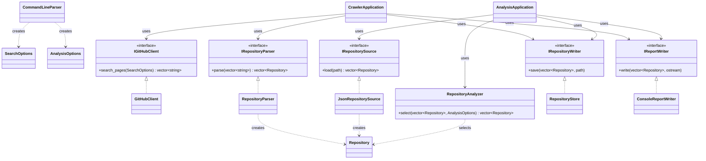

# Slitherer System Design

## Overview

Slitherer is a C++ GitHub repository crawler and analyzer. It can query the
GitHub Search API, convert the response into repository records, save the
records as JSON, and analyze a saved dataset by filtering, sorting, and
selecting the top results. This report refines the current implementation into
an object-oriented design suitable for the final refactoring. The design keeps
network access, parsing, analysis, and presentation separate so each part can be
tested without requiring GitHub or a particular filesystem.

## 1. Requirements Analysis

The following requirements describe observable behavior and provide IDs for the
test plan.

| ID | Requirement |
|---|---|
| R1 | The program shall accept a GitHub repository search query and a positive total result count, using documented defaults when arguments are omitted. |
| R2 | The program shall request up to the requested total count from GitHub, using pagination when necessary and an optional authentication token, and shall report a usable error when a request fails. |
| R3 | The program shall parse GitHub Search JSON into repository records containing owner, name, description, stars, forks, language, size, update time, and URL. JSON `null` descriptions and languages shall be represented as empty strings. |
| R4 | The program shall load a previously exported JSON array of repository records and reject an unreadable or malformed dataset. |
| R5 | Analysis shall retain repositories with stars greater than or equal to `min-stars`, and optionally retain only an exact language match. An empty language filter shall mean any language. |
| R6 | Analysis shall sort results by stars, forks, or update time in descending order, using owner and name as deterministic tie-breakers, and shall return no more than `top-n` records. |
| R7 | The program shall print a human-readable report and export the selected repositories as a valid, indented JSON array containing the same records. |
| R8 | Invalid command-line values, missing option values, unknown options, zero search counts, and negative numeric values shall produce an error and a nonzero exit status rather than silently using a fallback. |

The crawler workflow is:

1. Read command-line search options.
2. Request enough GitHub response pages to collect at most the requested total.
3. Parse the responses into `Repository` values.
4. Print and save `repositories.json`.

The analysis workflow is:

1. Read analysis options.
2. Load `repositories.json`.
3. Filter and sort the records.
4. Limit the result to `top-n`, save `selected.json`, and print the report.

## 2. System Design

### 2.1 Design rationale

The current implementation already has useful seams (`GitHubClient`,
`RepositoryParser`, and `RepositoryStore`), but loading, analysis, and some
output behavior are implemented as free functions. The refactoring will make
those responsibilities explicit objects and inject external dependencies
through interfaces. This follows single responsibility and dependency
inversion:

- API transport does not parse JSON.
- Parsing does not decide which repositories are selected.
- Analysis does not write files or print to the console.
- The application coordinates use cases but does not contain business rules.
- External failures are distinct from an empty successful result; they are
  reported as exceptions (or an equivalent explicit error type).

### 2.2 Major classes

#### `Repository`

`Repository` is the domain value object. It stores `owner`, `name`,
`description`, `stars`, `forks`, `language`, `size`, `updated_at`, and `url`.
It has no network or file dependencies. Its value semantics make it easy to
compare expected records in unit tests.

#### `SearchOptions` and `AnalysisOptions`

These structures hold validated use-case input. `SearchOptions` contains
`query` and `count`. `AnalysisOptions` contains `min_stars`, `language`,
`sort_key`, and `top_n`. Command-line parsing validates values before creating
these objects.

#### `IGitHubClient` / `GitHubClient`

`IGitHubClient` defines the API boundary. `GitHubClient` is the production
implementation using HTTPS and `GITHUB_TOKEN` when present. It URL-encodes the
query, requests pages of at most GitHub's page size, stops at the requested
total, and throws a `GitHubError` for transport or non-success HTTP responses.
A `FakeGitHubClient` can be used in tests, so tests do not depend on network
availability, rate limits, or credentials.

#### `IRepositoryParser` / `RepositoryParser`

`RepositoryParser` converts GitHub Search JSON response bodies into
`std::vector<Repository>`. It owns schema mapping, including nested
`owner.login` and nullable GitHub fields. It throws a parsing error for invalid
JSON or missing required fields instead of returning partial, success-shaped
data.

#### `IRepositorySource` / `JsonRepositorySource`

`JsonRepositorySource` loads the exported repository dataset from a path. It
validates that the root is an array and maps every required property. Keeping
loading separate from saving allows analysis tests to use an in-memory source
or a temporary fixture.

#### `RepositoryAnalyzer`

`RepositoryAnalyzer` owns the domain rules for filtering, sorting, and
limiting. Its public operation accepts a repository collection and
`AnalysisOptions`, returning a new collection without mutating the input. It
uses named comparator strategies (stars, forks, and updated time) and applies
stable deterministic tie-breakers.

Representative interface:

```cpp
class RepositoryAnalyzer {
public:
    std::vector<Repository> select(
        const std::vector<Repository>& input,
        const AnalysisOptions& options) const;
};
```

#### `IRepositoryWriter` / `RepositoryStore`

`RepositoryStore` serializes repository records to JSON and writes them to a
path. It reports open and write failures as exceptions. Reporting is deliberately
not part of this class; it belongs to `IReportWriter`, which prevents file
formatting and console formatting from becoming one responsibility.

#### `IReportWriter` / `ConsoleReportWriter`

`ConsoleReportWriter` formats the selected records and summary information for
the user. The interface permits a string-stream writer in tests, which makes
headers, counts, and selected rows directly assertable.

#### `CommandLineParser`

`CommandLineParser` converts `argc`/`argv` into either a crawl command or an
analysis command. It owns defaults, required-value checks, numeric validation,
and help text. It rejects unknown options and invalid values before invoking a
workflow. In particular, it validates a positive crawl count, allows
`top-n=0` as a valid empty selection, and rejects numeric overflow.

#### `CrawlerApplication`

`CrawlerApplication` coordinates the crawl use case: it obtains response
bodies from `IGitHubClient`, passes them to `IRepositoryParser`, then invokes
the writer and report writer.

#### `AnalysisApplication`

`AnalysisApplication` coordinates the analysis use case: it loads records from
`IRepositorySource`, asks `RepositoryAnalyzer` for the selected records, then
exports and reports them. It does not contain filtering or sorting rules.

### 2.3 Representative interfaces

```cpp
class IGitHubClient {
public:
    virtual ~IGitHubClient() = default;
    // Returns response bodies for pages; throws GitHubError on request failure.
    virtual std::vector<std::string> search_pages(
        const SearchOptions& options) const = 0;
};

class IRepositoryParser {
public:
    virtual ~IRepositoryParser() = default;
    virtual std::vector<Repository> parse(
        const std::vector<std::string>& bodies) const = 0;
};

class IRepositorySource {
public:
    virtual ~IRepositorySource() = default;
    virtual std::vector<Repository> load(
        const std::filesystem::path& path) const = 0;
};

class IRepositoryWriter {
public:
    virtual ~IRepositoryWriter() = default;
    virtual void save(const std::vector<Repository>& repositories,
                      const std::filesystem::path& path) const = 0;
};

class IReportWriter {
public:
    virtual ~IReportWriter() = default;
    virtual void write(const std::vector<Repository>& repositories,
                       std::ostream& output) const = 0;
};
```

The existing concrete `GitHubClient`, `RepositoryParser`, and
`RepositoryStore` can implement these interfaces with minimal behavior
changes. The current `filter_repositories` and `sort_repositories` functions
become the implementation of `RepositoryAnalyzer::select`; the current
`load_repositories`, `report_repositories`, and `export_repositories`
responsibilities move into the corresponding concrete classes.

### 2.4 Class relationships



The applications own or receive these collaborators through
`std::unique_ptr`/references. The arrows labeled “uses” are dependency
injection points; production code supplies real implementations, while tests
provide fakes. `Repository` is a value type used by the parser, source,
analyzer, and writers rather than a base class hierarchy.

### 2.5 Class interactions

For a crawl, `CommandLineParser` validates a `SearchOptions` value.
`CrawlerApplication` calls `IGitHubClient::search_pages`, passes all returned
bodies to `IRepositoryParser::parse`, and sends the resulting records to
`IRepositoryWriter`. It then invokes `IReportWriter`. A failed HTTP response
or malformed body is propagated as an explicit error and handled once at the
application boundary.

For analysis, `CommandLineParser` creates `AnalysisOptions`.
`AnalysisApplication` asks `IRepositorySource` for records and calls
`RepositoryAnalyzer::select`. The analyzer first applies the minimum-star and
language predicates, then selects the requested comparator, sorts descending,
and truncates to `top_n`. The selected records are passed unchanged to both
the JSON writer and report writer, ensuring the two outputs describe the same
result.

This design satisfies R1-R4 through the command, client, parser, and source
collaborators; R5-R6 through `RepositoryAnalyzer`; R7 through the two writer
interfaces; and R8 through `CommandLineParser` and explicit exception
handling. No class needs to know both transport details and analysis rules.

## 3. Test Design

The final milestone will implement these tests using a fake GitHub client,
temporary JSON files, and `std::ostringstream` report output. Tests should
compare structured values and exact required fields rather than only checking
that the executable terminates.

### 3.1 Planned test cases

| Test | Target | Input / setup | Expected result |
|---|---|---|---|
| T1 | R1, `CommandLineParser` | Parse no crawl query/count arguments. | Default query is `stars:>=0` and count is 100. |
| T2 | R1, R8, `CommandLineParser` | Parse a custom query and count of 25. | A `SearchOptions` with the exact query and count is produced. |
| T3 | R8, `CommandLineParser` | Try count `0`, `-1`, a nonnumeric value, a missing value, and an unknown option. | Each input is rejected with a descriptive error; no workflow is called. |
| T4 | R2, `GitHubClient` boundary | Configure a fake client with two pages and request 125 results. | The client requests/returns enough pages to meet the requested total, never exceeds it, and the unit test does not contact GitHub. |
| T5 | R2, error propagation | Configure a fake client to throw for an HTTP/network failure. | The crawl reports an error and does not write a successful dataset. |
| T6 | R3, `RepositoryParser` | Parse a valid GitHub response containing nested `owner.login`, one normal language, and null description/language. | One `Repository` has all mapped values; null fields become empty strings. |
| T7 | R3, parser errors | Pass malformed JSON, a non-object response, or an item missing `name`/`owner.login`. | Parsing throws a clear error and does not return partial success. |
| T8 | R4, `JsonRepositorySource` | Load a valid exported JSON array with two records. | Both records are reconstructed with the same field values. |
| T9 | R4, source errors | Use a missing file, a non-array root, and an array missing a required field. | Each case raises an error identifying the load/format problem. |
| T10 | R5, analyzer filtering | Analyze records with stars below, equal to, and above `min_stars`; repeat with an exact language and with an empty language. | Equal/above records remain; below records are removed; empty language accepts all languages. |
| T11 | R6, analyzer sorting | Provide ties in stars, forks, and update time, with different owners/names, and set `top_n=2`. | Correct descending key order is used, ties are owner/name ascending, and exactly at most two records are returned. |
| T12 | R6, edge limits | Analyze an empty input, `top_n=0`, and `top_n` larger than the input. | Empty input remains empty; zero returns no records; an oversized limit returns every eligible record without error. |
| T13 | R7, `RepositoryStore` | Save two repositories to a temporary path and parse the resulting file as JSON. | The file is a valid array, contains every field and value, and is indented/terminated as expected. |
| T14 | R7, writer errors | Save to an unavailable or unwritable path. | A write/open error is raised rather than silently succeeding. |
| T15 | R7, `ConsoleReportWriter` | Write a known selected list to an `ostringstream`. | Header, each owner/name and summary count are present and match the selected records. |
| T16 | R1-R8, crawl integration | Inject fake client, parser, writer, and report writer into `CrawlerApplication`. | One complete request-to-parse-to-save-to-report sequence occurs in order. |
| T17 | R4-R8, analysis integration | Inject a source containing a fixture dataset and writer/report fakes. | Filtered and sorted records sent to export/report exactly match the analyzer result. |

### 3.2 Coverage and evaluation plan

| Requirement | Supporting tests | Evidence recorded in the final milestone |
|---|---|---|
| R1 — query and count inputs | T1, T2, T16 | Parsed options and fake-client call arguments |
| R2 — GitHub retrieval and failure handling | T4, T5, T16 | Request options, response handling, and error result |
| R3 — JSON parsing | T6, T7 | Expected `Repository` values and rejected invalid fixtures |
| R4 — dataset loading | T8, T9, T17 | Loaded records and error messages |
| R5 — filtering | T10, T17 | Selected records for threshold/language cases |
| R6 — sorting and top limit | T11, T12, T17 | Ordered names and result count |
| R7 — output | T13, T14, T15, T16, T17 | Parsed output JSON and report text |
| R8 — validation | T3, T5, T7, T9, T14 | Nonzero/error behavior for invalid inputs and external failures |

The component tests isolate parsing, analysis, and output so a failure identifies
the responsible class. The two integration tests verify that dependency
injection does not break the complete workflows. Together, the normal,
boundary, malformed-input, and external-failure cases cover the observable
requirements without relying on a live GitHub service.
